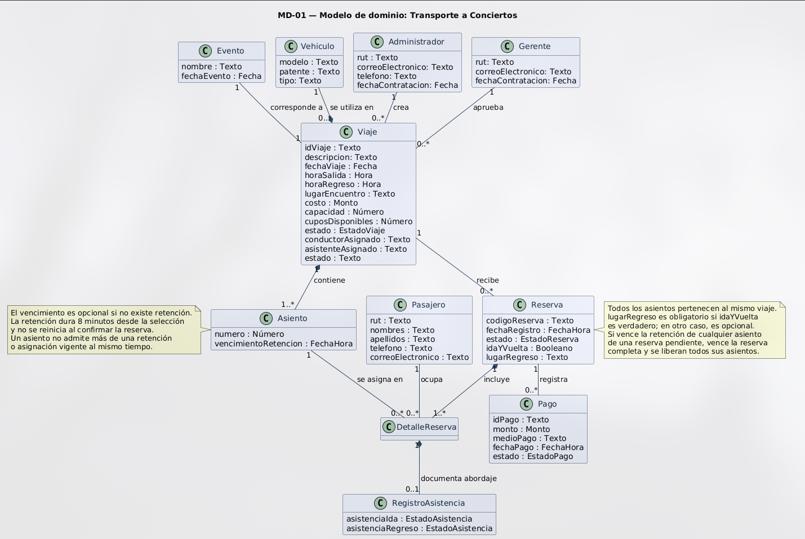

# Modelo de dominio

## Diagrama

Archivo fuente: [`./diagramas/modelo-dominio.puml`](./diagramas/modelo-dominio.puml)

## Descripción de las clases

| Clase | Qué representa en el negocio | Atributos |
|---|---|---|
| **Evento** | Concierto o evento al que se dirige el transporte. | `nombre: Texto`, `fechaEvento: Fecha` |
| **Vehiculo** | Vehículo utilizado para prestar el servicio de traslado. Puede ser un minibús (17 asientos) o un megabús (47 asientos). | `modelo: Texto`, `patente: Texto`, `tipo: TipoVehiculo` |
| **Administrador** | Persona responsable de crear los viajes ofrecidos. | `rut: Texto`, `correoElectronico: Texto`, `telefono: Texto`, `fechaContratacion: Fecha` |
| **Gerente** | Persona de la compañía que aprueba o rechaza los viajes creados en megabús. | `rut: Texto`, `correoElectronico: Texto`, `fechaContratacion: Fecha` |
| **Viaje** | Traslado organizado hacia un evento, con su información de salida, regreso y disponibilidad. | `idViaje: Texto`, `descripcion: Texto`, `fechaViaje: Fecha`, `horaSalida: Hora`, `horaRegreso: Hora`, `lugarEncuentro: Texto`, `costo: Monto`, `capacidad: Número`, `cuposDisponibles: Número`, `estado: EstadoViaje`, `estadoAprobacion: EstadoAprobacion`, `conductorAsignado: Texto`, `asistenteAsignado: Texto` |
| **Asiento** | Asiento físico de un viaje que conserva el vencimiento de su retención temporal. | `numero: Número`, `vencimientoRetencion: FechaHora` |
| **Pasajero** | Persona que ocupa un asiento incluido en una reserva. | `rut: Texto`, `nombres: Texto`, `apellidos: Texto`, `telefono: Texto`, `correoElectronico: Texto` |
| **Reserva** | Registro que agrupa uno o varios asientos del mismo viaje, identifica sus pasajeros mediante los detalles y conserva su estado y modalidad. | `codigoReserva: Texto`, `fechaRegistro: FechaHora`, `estado: EstadoReserva`, `idaYVuelta: Booleano`, `lugarRegreso: Texto` |
| **DetalleReserva** | Vínculo que identifica el asiento y el pasajero correspondiente dentro de una reserva. | Sin atributos propios; su información se expresa mediante las asociaciones. |
| **Pago** | Pago o intento de pago asociado a una reserva. | `idPago: Texto`, `monto: Monto`, `medioPago: Texto`, `fechaPago: FechaHora`, `estado: EstadoPago` |
| **RegistroAsistencia** | Registro de asistencia de ida y regreso del pasajero identificado en un detalle de reserva. | `asistenciaIda: EstadoAsistencia`, `asistenciaRegreso: EstadoAsistencia` |

## Asociaciones

| Asociación | Clases | Multiplicidades | Justificación |
|---|---|---|---|
| **corresponde a** | Evento – Viaje | `1` – `1` | El viaje corresponde al evento al que se transportará a los pasajeros. |
| **se utiliza en** | Vehiculo – Viaje | Cada viaje: `1` vehículo; cada vehículo: `0..*` viajes | El viaje utiliza un vehículo para realizar el traslado; un mismo vehículo puede utilizarse en varios viajes. El tipo del vehículo determina la capacidad del viaje y si requiere aprobación. |
| **contiene** | Viaje – Asiento | Cada viaje: `1..*` asientos; cada asiento: `1` viaje | Composición: cada viaje contiene sus asientos físicos (17 en minibús o 47 en megabús, según el vehículo) y un asiento no existe sin su viaje. |
| **incluye** | Reserva – DetalleReserva | Cada reserva: `1..*` detalles; cada detalle: `1` reserva | Composición: cada detalle pertenece a una reserva e identifica un asiento y su pasajero. |
| **se asigna en** | Asiento – DetalleReserva | Cada asiento: `0..*` detalles históricos; cada detalle: `1` asiento | El detalle identifica un asiento del mismo viaje que la reserva y conserva su asignación histórica. Un asiento no admite más de una retención o asignación vigente al mismo tiempo. |
| **crea** | Administrador – Viaje | Cada viaje: `1` administrador; cada administrador: `0..*` viajes | El administrador crea y registra viajes para publicarlos. |
| **aprueba** | Gerente – Viaje | Cada viaje: `0..1` gerente; cada gerente: `0..*` viajes | El gerente aprueba o rechaza los viajes en megabús. Los viajes en minibús no requieren gerente, y un viaje en megabús pendiente aún no lo tiene asignado. |
| **recibe** | Viaje – Reserva | Cada reserva: `1` viaje; cada viaje: `0..*` reservas | Un viaje recibe las reservas efectuadas por los pasajeros. |
| **ocupa** | Pasajero – DetalleReserva | Cada pasajero: `0..*` detalles; cada detalle: `1` pasajero | Cada detalle identifica al pasajero que ocupa el asiento correspondiente dentro de la reserva. |
| **registra** | Reserva – Pago | Cada pago: `1` reserva; cada reserva: `0..*` pagos | Una reserva puede registrar un pago, y este queda asociado a dicha reserva. |
| **documenta abordaje** | DetalleReserva – RegistroAsistencia | Cada detalle: `0..1` registros de asistencia; cada registro: `1` detalle | Composición: se documenta la asistencia individual de ida y regreso del pasajero identificado en el detalle. |

## Decisiones de modelado

- **Evento y Viaje se modelan de forma separada:** el evento corresponde al concierto y el viaje al traslado ofrecido hacia él.
- **Tipo de vehículo:** `Vehiculo.tipo` distingue entre minibús (17 asientos) y megabús (47 asientos). Reemplaza al atributo `capacidadPasajeros`, porque la capacidad se deduce del tipo.
- **Aprobación de viajes en megabús:** todo viaje tiene un `estadoAprobacion`. Un viaje en minibús queda `Aprobado` al crearse, sin intervención del gerente. Un viaje en megabús queda `Pendiente` hasta que el gerente lo aprueba (`Aprobado`) o lo rechaza (`Rechazado`). El estado es visible para el administrador.
- **Gerente se modela como clase:** como el administrador, registra datos propios (RUT, correo electrónico y fecha de contratación) y es quien decide sobre los viajes en megabús mediante la asociación `aprueba`.
- **`estadoAprobacion` es independiente de `estado`:** `estado` (`EstadoViaje`) describe el ciclo de vida del viaje, mientras que `estadoAprobacion` describe el resultado de la revisión del gerente.
- **Asiento se modela como clase independiente y composición:** cada viaje contiene asientos físicos numerados y un asiento no existe sin su viaje (`*--`). Cada asiento consume un cupo y la capacidad máxima del viaje es de 17 pasajeros/asientos en minibús o 47 en megabús. La disponibilidad considera tanto las retenciones temporales como las asignaciones vigentes, conservando el histórico. Un asiento no admite más de una retención o asignación vigente al mismo tiempo.
- **Reserva agrupa sus asientos mediante DetalleReserva:** una reserva contiene uno o varios detalles, todos correspondientes a asientos del mismo viaje, con un pasajero identificado por detalle. La composición `Reserva–DetalleReserva` expresa que un detalle pertenece a su reserva y no existe de manera autónoma.
- **La retención pertenece a Asiento:** `vencimientoRetencion` se guarda en el asiento y es opcional cuando no existe retención. El plazo es de 8 minutos desde la selección y no se reinicia al confirmar la reserva. Si vence cualquier retención de una reserva pendiente, vence toda la reserva y se liberan todos sus asientos.
- **La modalidad y el lugar de regreso pertenecen a Reserva:** `lugarRegreso` lo ingresa el pasajero y es obligatorio cuando `idaYVuelta` es verdadero; en otro caso, es opcional.
- **Administrador se modela como clase:** además de crear viajes, el diagrama registra sus datos propios (RUT, correo electrónico, teléfono y fecha de contratación), por lo que representa información del negocio y no solamente un actor.
- **RegistroAsistencia se modela como clase independiente y composición:** registra la asistencia individual de ida y regreso del pasajero identificado en un detalle de reserva; se modela como una composición fuerte (`*--`) desde `DetalleReserva`, ya que el registro de abordaje no existe de manera autónoma sin su detalle asociado.
- **Conductor y asistente asignados se representan como atributos de Viaje:** el diagrama no los define como clases independientes.
- **La descripción del viaje es opcional:** `descripcion` es un texto libre que el administrador puede ingresar al crear el viaje; no es obligatorio y no participa en las validaciones de creación.
- **Relaciones del modelo:** las relaciones son asociaciones simples binarias, con excepción de las composiciones `Viaje–Asiento`, `Reserva–DetalleReserva` y `DetalleReserva–RegistroAsistencia`.