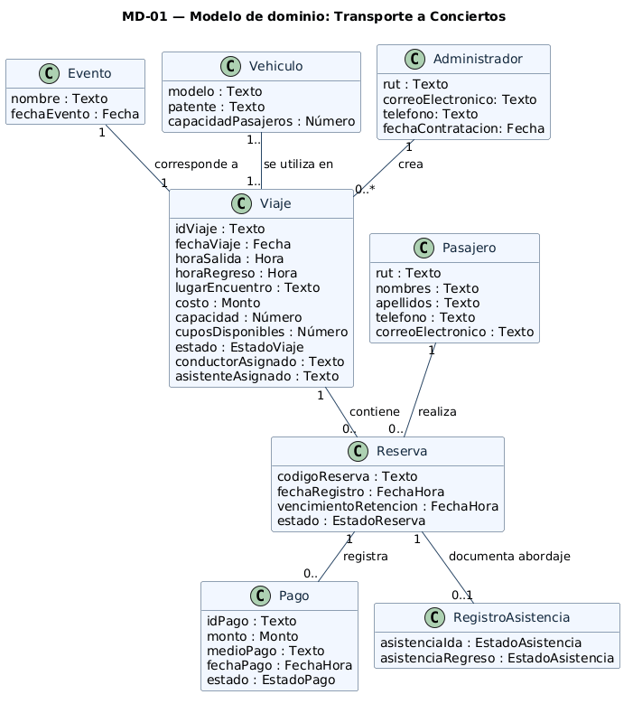

# Modelo de dominio

## Diagrama

Archivo fuente: [`./diagramas/modelo-dominio.puml`](./diagramas/modelo-dominio.puml)

## Descripción de las clases

| Clase | Qué representa en el negocio | Atributos |
|---|---|---|
| **Evento** | Concierto o evento al que se dirige el transporte. | `nombre: Texto`, `fechaEvento: Fecha` |
| **Vehiculo** | Vehículo utilizado para prestar el servicio de traslado. | `modelo: Texto`, `patente: Texto`, `capacidadPasajeros: Número` |
| **Administrador** | Persona responsable de crear los viajes ofrecidos. | `rut: Texto`, `correoElectronico: Texto`, `telefono: Texto`, `fechaContratacion: Fecha` |
| **Viaje** | Traslado organizado hacia un evento, con su información de salida, regreso y disponibilidad. | `idViaje: Texto`, `fechaViaje: Fecha`, `horaSalida: Hora`, `horaRegreso: Hora`, `lugarEncuentro: Texto`, `costo: Monto`, `capacidad: Número`, `cuposDisponibles: Número`, `estado: EstadoViaje`, `conductorAsignado: Texto`, `asistenteAsignado: Texto` |
| **Pasajero** | Persona que reserva un cupo en un viaje. | `rut: Texto`, `nombres: Texto`, `apellidos: Texto`, `telefono: Texto`, `correoElectronico: Texto` |
| **Reserva** | Registro que vincula al pasajero con un viaje y conserva el estado de su cupo. | `codigoReserva: Texto`, `fechaRegistro: FechaHora`, `vencimientoRetencion: FechaHora`, `estado: EstadoReserva` |
| **Pago** | Pago o intento de pago asociado a una reserva. | `idPago: Texto`, `monto: Monto`, `medioPago: Texto`, `fechaPago: FechaHora`, `estado: EstadoPago` |
| **RegistroAsistencia** | Registro de la asistencia del pasajero en la ida y el regreso del viaje. | `asistenciaIda: EstadoAsistencia`, `asistenciaRegreso: EstadoAsistencia` |

## Asociaciones

| Asociación | Clases | Multiplicidades | Justificación |
|---|---|---|---|
| **corresponde a** | Evento – Viaje | `1` – `1` | El viaje corresponde al evento al que se transportará a los pasajeros. |
| **se utiliza en** | Vehiculo – Viaje | `1..` – `1..` (incompletas en el diagrama) | El viaje utiliza un vehículo para realizar el traslado. |
| **crea** | Administrador – Viaje | Cada viaje: `1` administrador; cada administrador: `0..*` viajes | El administrador crea y registra viajes para publicarlos. |
| **contiene** | Viaje – Reserva | Cada reserva: `1` viaje; cada viaje: `0..` reservas (incompleta en el diagrama) | Un viaje contiene las reservas efectuadas por los pasajeros. |
| **realiza** | Pasajero – Reserva | Cada reserva: `1` pasajero; cada pasajero: `0..` reservas (incompleta en el diagrama) | Cada reserva está asociada al pasajero que la realiza. |
| **registra** | Reserva – Pago | Cada pago: `1` reserva; cada reserva: `0..` pagos (incompleta en el diagrama) | Una reserva puede registrar un pago, y este queda asociado a dicha reserva. |
| **documenta abordaje** | Reserva – RegistroAsistencia | Cada registro de asistencia: `1` reserva; cada reserva: `0..1` registros de asistencia | Se documenta la asistencia de ida y regreso correspondiente a la reserva del pasajero. |

## Decisiones de modelado

- **Evento y Viaje se mantienen separados:** el evento corresponde al concierto y el viaje al traslado ofrecido hacia él.
- **Administrador se modela como clase:** además de crear viajes, el diagrama registra sus datos propios (RUT, correo electrónico, teléfono y fecha de contratación), por lo que representa información del negocio y no solamente un actor.
- **RegistroAsistencia se modela como clase independiente:** registra la asistencia de ida y regreso asociada a una reserva.
- **Conductor y asistente asignados se representan como atributos de Viaje:** el diagrama no los define como clases independientes.
- **No se emplearon herencia, agregación ni composición:** las siete relaciones mostradas son asociaciones simples.
- **Multiplicidades por completar:** el diagrama entregado muestra las expresiones `1..` y `0..` sin un límite superior. Deben completarse en el diagrama UML fuente y en la tabla cuando el equipo confirme las cardinalidades; no se asume un valor que no está indicado en la imagen.
