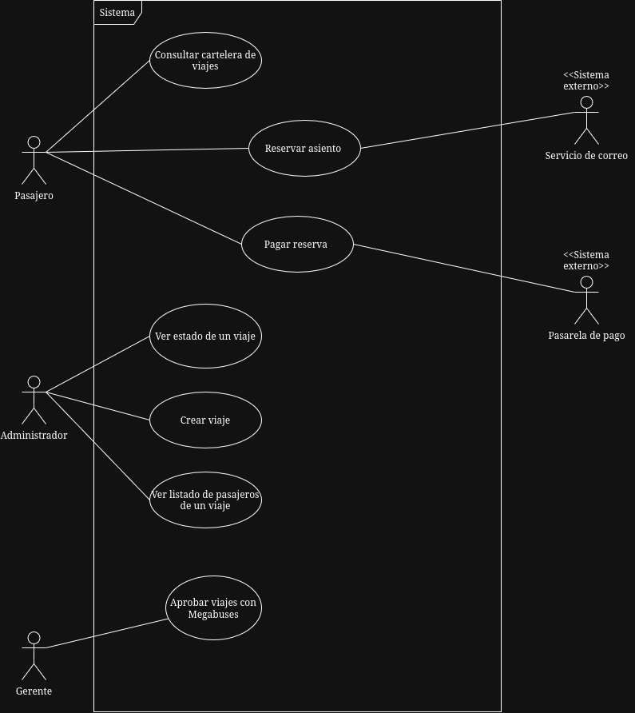

# Casos de uso
 
## Actores
| Actor | Tipo (humano / sistema externo) | Descripción |
|-------|----------------------------------|-------------|
| Pasajero | Humano | Consulta los viajes disponibles y realiza una reserva para asistir a un concierto. |
| Administrador | Humano | Persona encargada de crear y publicar viajes y gestionar la información de sus pasajeros. |
| Pasarela de pago | Sistema externo | Servicio que procesa los pagos en línea realizados por los pasajeros. |
| Servicio de correo | Sistema externo | Servicio que envía al pasajero la confirmación de su reserva. |
 
## Diagrama de casos de uso

 
Archivo fuente: [`./diagramas/casos-de-uso.drawio`](./diagramas/casos-de-uso.drawio)
 
## Casos de uso y su origen
| ID | Caso de uso (objetivo del actor) | Actor principal | Historia de origen |
|----|-----------------------------------|-----------------|---------------------|
| CU-01 | Consultar cartelera de viajes | Pasajero | [HU-01](./04-historias-usuario.md#hu-01-consultar-la-cartelera-de-viajes) |
| CU-02 | Reservar asiento | Pasajero | [HU-02](./04-historias-usuario.md#hu-02-registrar-reserva-y-pasajero) |
| CU-03 | Pagar reserva | Pasajero | [HU-05](./04-historias-usuario.md#hu-05-pagar-reserva) |
| CU-04 | Crear viaje | Administrador | [HU-03](./04-historias-usuario.md#hu-03-crear-un-viaje-en-el-sistema) |
| CU-05 | Ver listado de pasajeros de un viaje | Administrador | [HU-04](./04-historias-usuario.md#hu-04-visualizar-pasajeros) |
