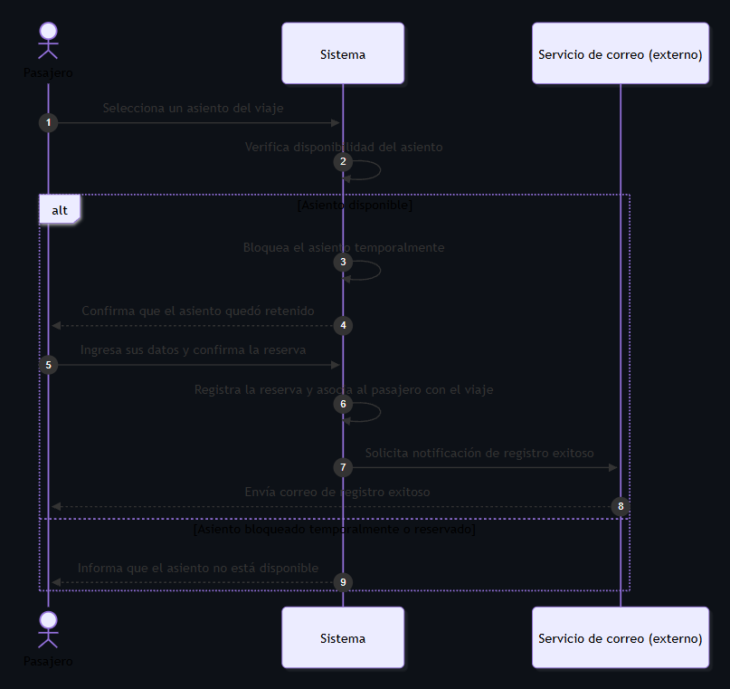
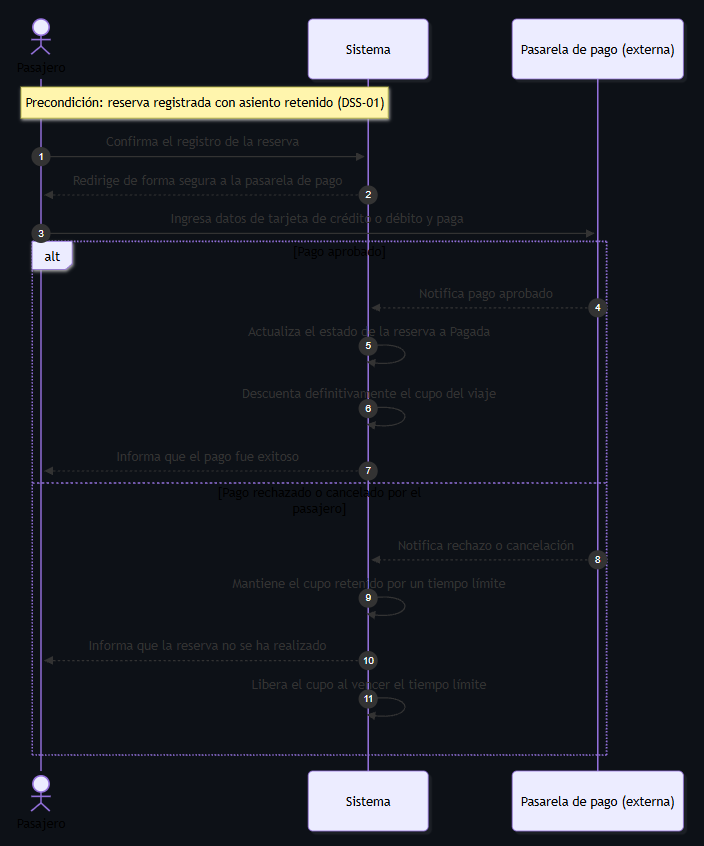

# Diagramas de secuencia de sistema

## DSS-01 — Reservar asiento y registrar pasajero

- Caso de uso: [CU-02](./09-casos-de-uso.md#cu-02)
- Historia: [HU-02](./04-historias-usuario.md#hu-02)
- Sistemas externos que participan: Servicio de correo (caja negra)

Archivo fuente: [`./diagramas/dss-01.mmd`](./diagramas/dss-01.mmd)

Variantes representadas:

- `alt` Asiento disponible: el sistema bloquea el asiento de forma temporal, recibe los datos del pasajero, registra la reserva asociándola al viaje y solicita al servicio de correo externo el envío de la notificación de registro exitoso.
- `alt` Asiento bloqueado temporalmente o reservado: el sistema impide la selección e informa al pasajero que el asiento no está disponible.

## DSS-02 — Pagar reserva

- Caso de uso: [CU-05](./09-casos-de-uso.md#cu-05)
- Historia: [HU-05](./04-historias-usuario.md#hu-05)
- Sistemas externos que participan: Pasarela de pago (caja negra)

Archivo fuente: [`./diagramas/dss-02.mmd`](./diagramas/dss-02.mmd)

Variantes representadas:

- `alt` Pago aprobado: la pasarela notifica la aprobación, el sistema cambia la reserva a Pagada, descuenta definitivamente el cupo e informa al pasajero.
- `alt` Pago rechazado o cancelado: la pasarela notifica el rechazo o la cancelación, el sistema mantiene el cupo retenido por un tiempo límite, informa que la reserva no se ha realizado y libera el cupo al vencer ese plazo.
