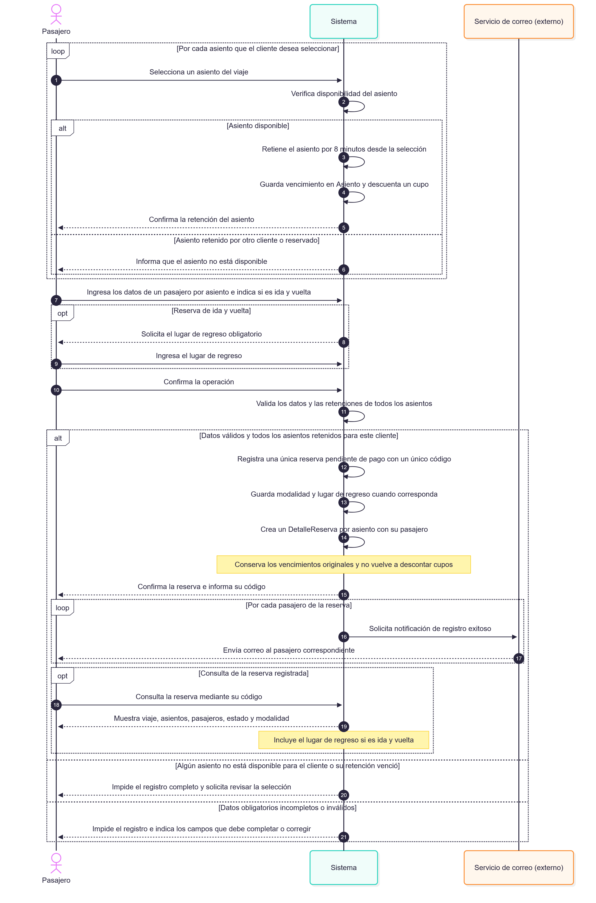
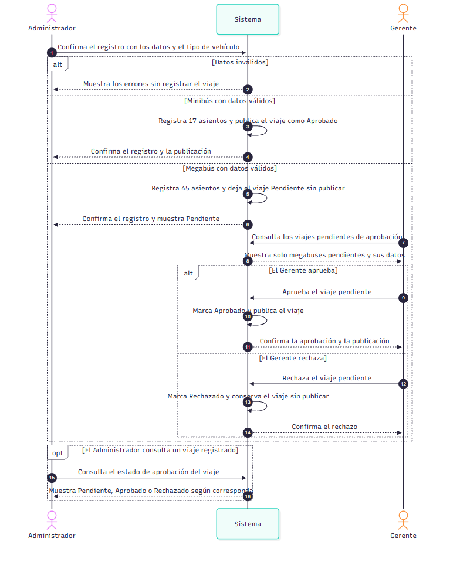

# Diagramas de secuencia de sistema

## DSS-01 — Reservar asiento y registrar pasajero

- Caso de uso: [CU-02](./09-casos-de-uso.md#cu-02)
- Historia: [HU-02](./04-historias-usuario.md#hu-02-registrar-reserva-y-pasajero)
- Sistemas externos que participan: Servicio de correo (caja negra)

Archivo fuente: [`./diagramas/dss-01.mmd`](./diagramas/dss-01.mmd)

Flujo y variantes representadas:

- `loop` Selección de asientos: el cliente puede seleccionar uno o varios asientos del mismo viaje.
- `alt` Asiento disponible: el sistema retiene el asiento durante 8 minutos desde su selección, guarda el vencimiento en `Asiento`, descuenta un cupo y confirma la retención.
- `alt` Asiento retenido por otro cliente o reservado: el sistema impide la selección e informa que el asiento no está disponible.
- Registro de datos: el cliente ingresa los datos de un pasajero por asiento e indica si la reserva incluye ida y vuelta.
- `opt` Reserva de ida y vuelta: el sistema solicita el lugar de regreso obligatorio y el cliente lo ingresa.
- `alt` Datos válidos y retenciones vigentes para el cliente: el sistema registra una única reserva pendiente de pago con un único código y un `DetalleReserva` por asiento con su pasajero. Conserva los vencimientos originales y no vuelve a descontar cupos.
- `alt` Pérdida de disponibilidad o retención vencida: el sistema impide el registro completo, sin crear una reserva parcial, y solicita revisar la selección.
- `alt` Datos obligatorios incompletos o inválidos: el sistema impide el registro e indica los campos que deben completarse o corregirse.
- `loop` Notificación por pasajero: el sistema solicita al Servicio de correo externo una notificación de registro exitoso para cada pasajero.
- `opt` Consulta de la reserva: mediante su código, el cliente consulta el viaje, los asientos, sus pasajeros, el estado y la modalidad; si incluye ida y vuelta, también se muestra el lugar de regreso.

## DSS-02 — Pagar reserva

- Caso de uso: [CU-03](./09-casos-de-uso.md#cu-03)
- Historia: [HU-05](./04-historias-usuario.md#hu-05-pagar-reserva)
- Sistemas externos que participan: Pasarela de pago (caja negra)

Archivo fuente: [`./diagramas/dss-02.mmd`](./diagramas/dss-02.mmd)

Flujo y variantes representadas:

- Precondición: existe una reserva pendiente de pago con todos sus asientos retenidos. Cada asiento guarda su propio vencimiento de retención (8 minutos desde su selección en DSS-01).
- Verificación inicial: el sistema comprueba que la reserva siga pendiente y todas sus retenciones estén vigentes; calcula el total (`costo del viaje × cantidad de asientos`) y crea el intento de `Pago` en estado Pendiente.
- `alt` Reserva vencida o alguna retención vencida al iniciar: el sistema aplica el vencimiento completo de EST-01, impide iniciar el pago e informa que la reserva está vencida.
- `alt` Pago aprobado y todas las retenciones vigentes: la pasarela notifica la aprobación, el sistema registra el `Pago` como Aprobado, cambia la reserva a Pagada, confirma todos sus asientos sin volver a descontar cupos e informa al pasajero.
- `alt` Aprobación tardía (reserva vencida o alguna retención vencida): el sistema registra el `Pago` como Aprobado, aplica el vencimiento completo de la reserva, registra la solicitud de devolución, la solicita a la pasarela e informa que el pago no confirmó los cupos. No reactiva la reserva ni vuelve a ocupar sus asientos.
- `opt` Confirmación de devolución completa: la pasarela confirma la devolución solicitada, el `Pago` pasa a Devuelto y el sistema informa que el monto fue devuelto. Mientras no se confirme, el `Pago` permanece Aprobado y no se presenta como devuelto.
- `alt` Pago rechazado o cancelado: la pasarela notifica el rechazo o la cancelación, el sistema registra el `Pago` como Rechazado o Cancelado, informa que el pago no fue completado y conserva los vencimientos originales de los asientos, sin reiniciar plazos.
- `opt` Reintento: mientras la reserva siga pendiente y todas las retenciones sigan vigentes, el pasajero puede iniciar otro intento de pago por el total; el sistema conserva el historial de intentos.
- `par` Seguimiento de las retenciones por asiento: en paralelo al resultado del pago, si vence cualquier retención mientras la reserva sigue pendiente, el sistema marca toda la reserva como Vencida, libera todos sus asientos y restituye sus cupos.

## DSS-03 — Crear viaje y aprobación del gerente

- Casos de uso: [CU-04](./09-casos-de-uso.md#cu-04) (Crear viaje), [CU-06](./09-casos-de-uso.md#cu-06) (Aprobar o rechazar viaje con megabús) y [CU-07](./09-casos-de-uso.md#cu-07) (Ver estado de aprobación de un viaje).
- Historias: [HU-03](./04-historias-usuario.md#hu-03--crear-un-viaje-en-el-sistema) (registro y consulta) y [HU-06](./04-historias-usuario.md#hu-06--aprobar-o-rechazar-un-viaje-con-megabús) (revisión del Gerente).
- Diagrama de estado: [EST-03](./11-diagramas-estado.md#est-03--ciclo-de-aprobación-de-un-viaje-con-megabús).
- Sistemas externos que participan: ninguno. El Gerente es un actor humano de la compañía.

Archivo fuente: [`./diagramas/dss-03.mmd`](./diagramas/dss-03.mmd)

Flujo y variantes representadas:

1. El Administrador confirma el registro con los datos del viaje y el tipo de vehículo. Si los datos son inválidos, el sistema muestra los errores y no registra el viaje.
2. Si es **minibús**, el sistema lo registra con **17 asientos** y estado **Aprobado**, lo publica directamente y confirma el resultado al Administrador.
3. Si es **megabús**, el sistema lo registra con **45 asientos** y estado **Pendiente**, sin publicarlo. Cuando el Gerente consulta la bandeja, el sistema muestra únicamente los viajes con megabús pendientes y sus datos.
4. Si el Gerente **aprueba** un viaje pendiente, el sistema lo marca **Aprobado** y lo publica. Si lo **rechaza**, lo marca **Rechazado** y conserva el registro fuera de la cartelera. En ambos casos, confirma el resultado al Gerente.
5. El Administrador puede consultar el estado de aprobación de un viaje registrado: **Pendiente**, **Aprobado** o **Rechazado** (`Viaje.estadoAprobacion`).
