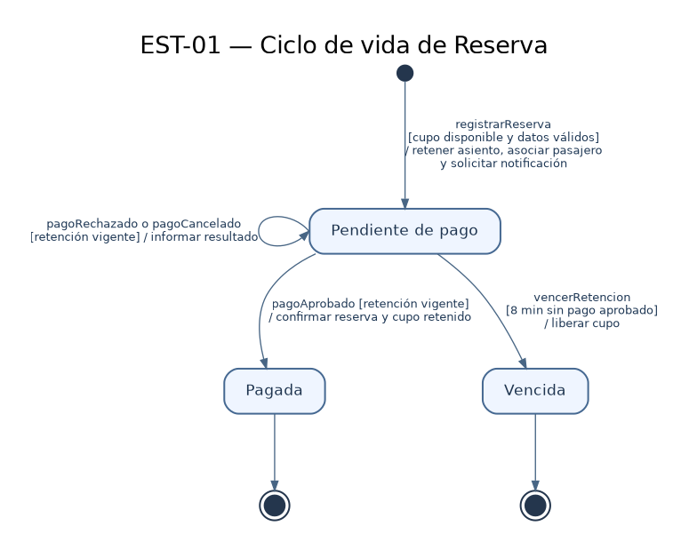
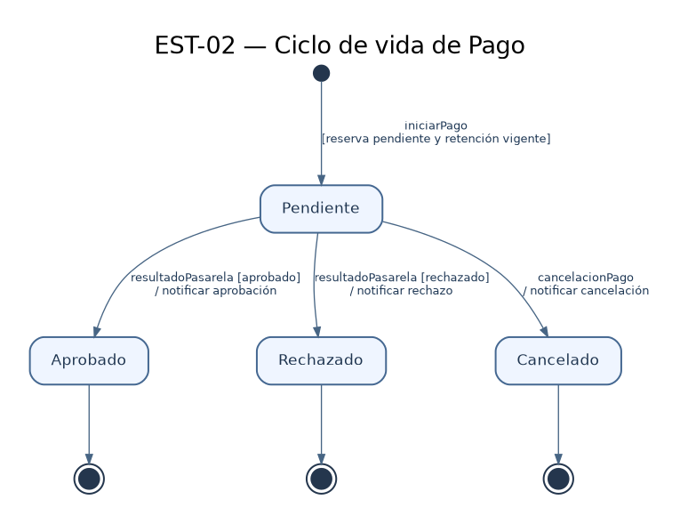

# Diagramas de estado

## EST-01 — Ciclo de vida de Reserva

- Clase del dominio: [`Reserva`](./08-modelo-dominio.md)
- Diagramas de secuencia relacionados: DSS-01 (reserva y notificación) y DSS-02 (pago).

Archivo fuente: [`./diagramas/est-01.puml`](./diagramas/est-01.puml)

### Tabla de transiciones

| Estado origen | Evento | Guarda | Acción | Estado destino |
|---|---|---|---|---|
| Inicial | `registrarReserva` | Asiento disponible y datos del pasajero válidos | Retener temporalmente el asiento, asociar el pasajero al viaje, registrar la reserva y solicitar notificación al servicio de correo. | Pendiente de pago |
| Pendiente de pago | `pagoAprobado` | Pago aprobado por la pasarela y retención vigente | Actualizar la reserva a Pagada y confirmar definitivamente el cupo retenido. | Pagada |
| Pendiente de pago | `pagoRechazado` | Retención vigente | Informar el rechazo del pago y mantener el cupo retenido hasta el límite establecido. | Pendiente de pago |
| Pendiente de pago | `pagoCancelado` | Retención vigente | Informar la cancelación del pago y mantener el cupo retenido hasta el límite establecido. | Pendiente de pago |
| Pendiente de pago | `vencerRetencion` | Han transcurrido 8 minutos sin pago aprobado | Liberar el cupo y marcar la reserva como vencida. | Vencida |
| Pagada | Finalización del ciclo | — | — | Final |
| Vencida | Finalización del ciclo | — | — | Final |

## EST-02 — Ciclo de vida de Pago

- Clase del dominio: [`Pago`](./08-modelo-dominio.md)
- Diagramas de secuencia relacionados: DSS-02 (pago mediante pasarela externa).

Archivo fuente: [`./diagramas/est-02.puml`](./diagramas/est-02.puml)

### Tabla de transiciones

| Estado origen | Evento | Guarda | Acción | Estado destino |
|---|---|---|---|---|
| Inicial | `iniciarPago` | Existe una reserva pendiente con retención vigente | Iniciar el pago en la pasarela externa. | Pendiente |
| Pendiente | `resultadoPasarela` | Pago aprobado | Registrar el pago como aprobado y notificar el resultado al sistema para confirmar la reserva. | Aprobado |
| Pendiente | `resultadoPasarela` | Pago rechazado | Registrar el pago como rechazado y comunicar el rechazo; la reserva conserva su retención hasta el plazo límite. | Rechazado |
| Pendiente | `cancelacionPago` | El pasajero cancela la operación | Registrar el pago como cancelado y comunicar la cancelación; la reserva conserva su retención hasta el plazo límite. | Cancelado |
| Aprobado | Finalización del ciclo | — | — | Final |
| Rechazado | Finalización del ciclo | — | — | Final |
| Cancelado | Finalización del ciclo | — | — | Final |
