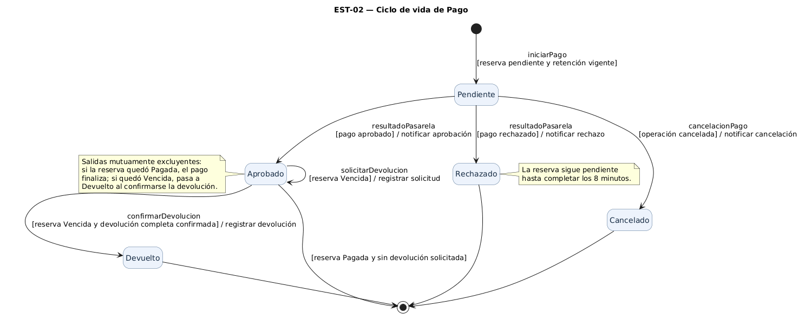

# Diagramas de estado

## EST-01 — Ciclo de vida de Reserva

- Clase del dominio: [`Reserva`](./08-modelo-dominio.md)
- Diagramas de secuencia relacionados: DSS-01 (reserva y notificación) y DSS-02 (pago).

Archivo fuente: [`./diagramas/est-01.puml`](./diagramas/est-01.puml)

### Tabla de transiciones

| Estado origen | Evento | Guarda | Acción | Estado destino |
|---|---|---|---|---|
| Inicial | `registrarReserva` | Datos obligatorios válidos y todas las retenciones vigentes para el cliente | Registrar una reserva con código único y sus detalles, asociar el viaje y solicitar una notificación a cada pasajero. | Pendiente de pago |
| Pendiente de pago | `pagoAprobado` | Pago aprobado por la pasarela y todas las retenciones vigentes | Confirmar la reserva y todos sus asientos sin descontar cupos nuevamente. | Pagada |
| Pendiente de pago | `pagoRechazado` | Todas las retenciones vigentes | Informar el rechazo y conservar los vencimientos originales de los asientos. | Pendiente de pago |
| Pendiente de pago | `pagoCancelado` | Todas las retenciones vigentes | Informar la cancelación y conservar los vencimientos originales de los asientos. | Pendiente de pago |
| Pendiente de pago | `vencerRetencion` | Vence cualquier retención sin pago aprobado | Marcar toda la reserva como vencida, liberar todos sus asientos y restituir sus cupos. | Vencida |
| Pagada | Finalización del ciclo | — | — | Final |
| Vencida | Finalización del ciclo | — | — | Final |

Cada asiento guarda su vencimiento de retención, correspondiente a 8 minutos desde su selección en DSS-01. Registrar la reserva no reinicia los plazos ni vuelve a descontar cupos. El primer vencimiento de sus asientos provoca el vencimiento de toda la reserva pendiente. Una vez pagada, las retenciones dejan de provocar el vencimiento de la reserva.

## EST-02 — Ciclo de vida de Pago

- Clase del dominio: [`Pago`](./08-modelo-dominio.md)
- Diagramas de secuencia relacionados: DSS-02 (pago mediante pasarela externa).

Archivo fuente: [`./diagramas/est-02.puml`](./diagramas/est-02.puml)

### Tabla de transiciones

| Estado origen | Evento | Guarda | Acción | Estado destino |
|---|---|---|---|---|
| Inicial | `iniciarPago` | Existe una reserva pendiente con retención vigente | Iniciar el pago en la pasarela externa. | Pendiente |
| Pendiente | `resultadoPasarela` | Pago aprobado | Registrar el pago como aprobado y notificar el resultado al sistema para confirmar la reserva. | Aprobado |
| Pendiente | `resultadoPasarela` | Pago rechazado | Registrar el pago como rechazado y comunicar el rechazo; la reserva conserva su retención hasta el plazo límite. | Rechazado |
| Pendiente | `cancelacionPago` | El pasajero cancela la operación | Registrar el pago como cancelado y comunicar la cancelación; la reserva conserva su retención hasta el plazo límite. | Cancelado |
| Aprobado | Finalización del ciclo | — | — | Final |
| Rechazado | Finalización del ciclo | — | — | Final |
| Cancelado | Finalización del ciclo | — | — | Final |
