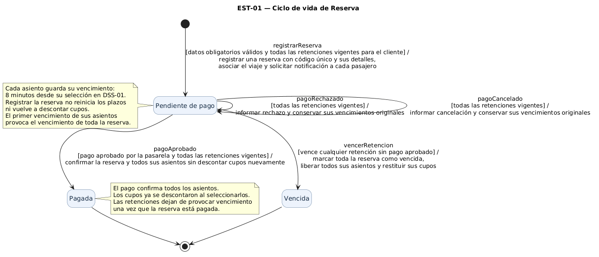
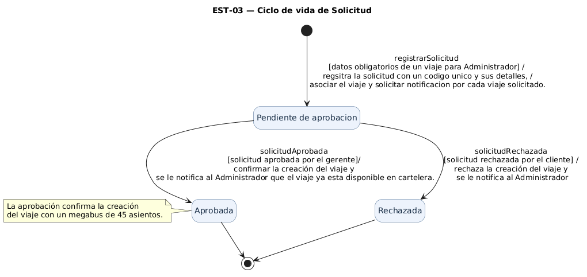

# Diagramas de estado

## EST-01 — Ciclo de vida de Reserva

- Clase del dominio: [`Reserva`](./08-modelo-dominio.md)
- Diagramas de secuencia relacionados: DSS-01 (reserva y notificación) y DSS-02 (pago).

Archivo fuente: [`./diagramas/est-01.puml`](./diagramas/est-01.puml)

### Tabla de transiciones

| Estado origen | Evento | Guarda | Acción | Estado destino |
|---|---|---|---|---|
| Inicial | `registrarReserva` | Datos obligatorios válidos y todas las retenciones vigentes para el cliente | Registrar una reserva con código único y sus detalles, asociar el viaje y solicitar una notificación a cada pasajero. | Pendiente de pago |
| Pendiente de pago | `pagoAprobado` | Pago aprobado por la pasarela y todas las retenciones vigentes | Confirmar la reserva y todos sus asientos sin descontar cupos nuevamente. | Pagada |
| Pendiente de pago | `pagoRechazado` | Todas las retenciones vigentes | Informar el rechazo y conservar los vencimientos originales de los asientos. | Pendiente de pago |
| Pendiente de pago | `pagoCancelado` | Todas las retenciones vigentes | Informar la cancelación y conservar los vencimientos originales de los asientos. | Pendiente de pago |
| Pendiente de pago | `vencerRetencion` | Vence cualquier retención sin pago aprobado | Marcar toda la reserva como vencida, liberar todos sus asientos y restituir sus cupos. | Vencida |
| Pagada | Finalización del ciclo | — | — | Final |
| Vencida | Finalización del ciclo | — | — | Final |

Cada asiento guarda su vencimiento de retención, correspondiente a 8 minutos desde su selección en DSS-01. Registrar la reserva no reinicia los plazos ni vuelve a descontar cupos. El primer vencimiento de sus asientos provoca el vencimiento de toda la reserva pendiente. Una vez pagada, las retenciones dejan de provocar el vencimiento de la reserva.

## EST-02 — Ciclo de vida de Pago

- Clase del dominio: [`Pago`](./08-modelo-dominio.md)
- Diagramas de secuencia relacionados: DSS-02 (pago mediante pasarela externa).

Archivo fuente: [`./diagramas/est-02.puml`](./diagramas/est-02.puml)

### Tabla de transiciones

| Estado origen | Evento | Guarda | Acción | Estado destino |
|---|---|---|---|---|
| Inicial | `iniciarPago` | Existe una reserva pendiente con retención vigente | Iniciar el pago en la pasarela externa. | Pendiente |
| Pendiente | `resultadoPasarela` | Pago aprobado | Registrar el pago como aprobado y notificar el resultado al sistema para confirmar la reserva. | Aprobado |
| Pendiente | `resultadoPasarela` | Pago rechazado | Registrar el pago como rechazado y comunicar el rechazo; la reserva conserva su retención hasta el plazo límite. | Rechazado |
| Pendiente | `cancelacionPago` | El pasajero cancela la operación | Registrar el pago como cancelado y comunicar la cancelación; la reserva conserva su retención hasta el plazo límite. | Cancelado |
| Aprobado | Finalización del ciclo | Pago aprobado con la reserva Pagada y sin devolución solicitada | — | Final |
| Aprobado | `solicitarDevolucion` | La reserva está vencida; si aún figura pendiente, se aplica primero el vencimiento completo | Registrar la solicitud y solicitar automáticamente la devolución del monto completo. | Aprobado |
| Aprobado | `confirmarDevolucion` | La reserva está Vencida y la pasarela confirma la devolución completa solicitada | Registrar la devolución e informar al pasajero. | Devuelto |
| Rechazado | Finalización del ciclo | — | — | Final |
| Cancelado | Finalización del ciclo | — | — | Final |
| Devuelto | Finalización del ciclo | — | — | Final |

Las salidas desde **Aprobado** son mutuamente excluyentes según el estado de la reserva: si la reserva quedó **Pagada**, el pago finaliza; si quedó **Vencida**, permanece **Aprobado** mientras la devolución no esté confirmada y luego pasa a **Devuelto**. No se agrega un estado «Devolución pendiente». La devolución no genera una transición de `Reserva`: esta permanece **Vencida**.

## EST-03 — Ciclo de aprobación de un viaje con megabús

- Clase del dominio relacionada: [`Viaje`](./08-modelo-dominio.md). El diagrama actual llama «Solicitud» al objeto que pasa por la aprobación.
- Historia relacionada: [HU-06 — Crear viaje con megabús](./04-historias-usuario.md#hu-06----crear-viaje-con-megabus).
- Diagrama de secuencia relacionado: [DSS-03](./diagramas/dss-03.mmd), en las ramas de aprobación y rechazo del viaje con megabús.

Archivo fuente: [`./diagramas/est-03.puml`](./diagramas/est-03.puml)

### Tabla de transiciones

| Estado origen | Evento | Guarda | Acción | Estado destino |
|---|---|---|---|---|
| Inicial | `registrarSolicitud` | El Administrador confirma un viaje con megabús con los datos obligatorios completos | Registrar la solicitud asociada al viaje y enviarla al Gerente para revisión, sin publicar el viaje. | Pendiente de aprobación |
| Pendiente de aprobación | `solicitudAprobada` | El Gerente aprueba la solicitud | Publicar el viaje en la cartelera y mostrar el resultado al Administrador. | Aprobada |
| Pendiente de aprobación | `solicitudRechazada` | El Gerente rechaza la solicitud | Descartar la publicación del viaje y mostrar el resultado al Administrador. | Rechazada |
| Aprobada | Finalización del ciclo | — | — | Final |
| Rechazada | Finalización del ciclo | — | — | Final |

El viaje con minibús no pasa por este ciclo de aprobación. La imagen y el archivo fuente aún mencionan al «cliente» en el rechazo; según HU-06 y DSS-03, esa decisión corresponde al Gerente. La nota del diagrama sobre los 45 asientos no figura en los criterios de aceptación de HU-06 y queda pendiente de confirmación.
